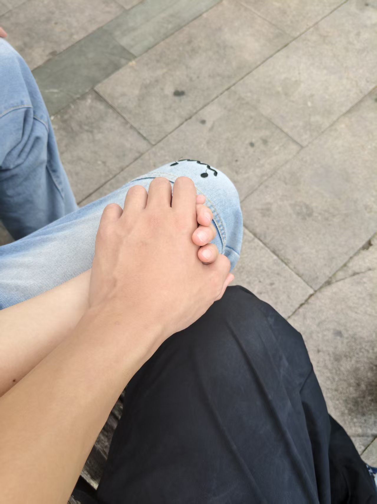

# this-is-food
no
<!DOCTYPE html>
<html lang="zh-CN">
<head>
    <meta charset="UTF-8">
    <meta name="viewport" content="width=device-width, initial-scale=1.0">
    <title>表白信</title>
</head>
<body style="background-color: rgb(226, 213, 209);">
    <h1>亲爱的你：</h1>
    
今天是我们相爱的第97天，时间过得真快，但我的爱却越来越深。每每见到你，我都会露出无比幸福的笑容。你如茉莉花般纯洁美丽，让我沉醉其中。
又如玫瑰花般带着刺，即便如此，我依然愿意去抚摸你。路漫漫其修远兮，吾将上下而求索。愿我们携手走过每一个春夏秋冬，吻遍春天的每一朵花，感受夏天最火热的日落，
踏过秋天的落叶，迎接冬天的第一场雪，愿我们的爱情如同这四季般美丽。花开花落，岁月如歌，愿我与你经久不衰，愿我与你白头偕老。我爱你，直到永远。

    

    
----FR

    

    

↑My Lover,accompanied longer forever

<pre style="font-size: 150%;"><cite style="font-family: 'Gill Sans', 'Gill Sans MT', Calibri, 'Trebuchet MS', sans-serif;color: firebrick;">《Sentiment》</cite>
    拍摄于2026年7月27日
</pre>
</body>
</html>
